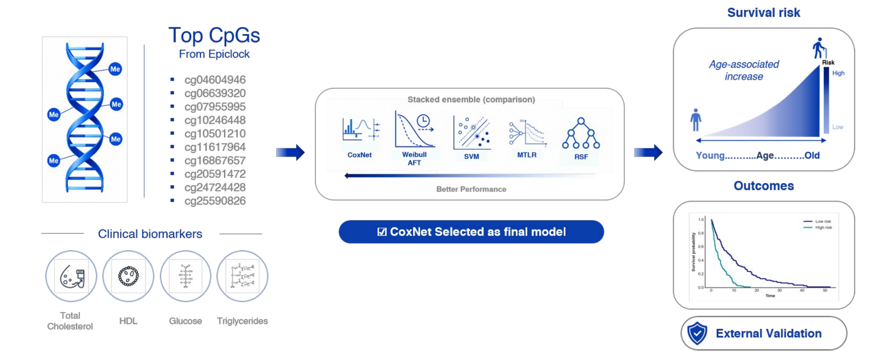

# Decoupling chronological-age signal from mortality signal across first- and second-generation epigenetic clocks

This repository contains the analysis code for our study testing whether ten CpGs selected for age prediction (EpiClock) also carry information about mortality once chronological age is taken into account. Models were developed in the Framingham Heart Study (FHS) and validated in the Women's Health Initiative (WHI), and the results were compared with the Horvath, Hannum, PhenoAge and GrimAge clocks.

[](docs/graphical_abstract.png)

## Usage

The folders are numbered in the order they are run.

1. **01_preprocessing**: quality control of the 450K methylation data, KNN imputation and ComBat batch correction.
2. **02_model_training**: trains CoxNet, Weibull AFT, survival SVM, MTLR and random survival forest on the 10 CpGs, with and without four clinical markers, plus a stacked ensemble.
3. **03_epigenetic_clocks**: calculates the Horvath, Hannum, PhenoAge and GrimAge clocks with pyaging.
4. **04_main_analyses**: converts the CoxNet risk score to years and fits Cox models with and without adjustment for age and sex, for our score and for each clock.
5. **05_figures_and_tables**: produces the manuscript figures and tables from the saved results.

Two further folders are optional:

- **06_revision_analyses**: additional analyses requested during peer review, one subfolder per reviewer comment.
- **07_supporting_analyses**: robustness checks that are not reported in the manuscript.

To find the code behind a particular table or figure, see [PAPER_TO_CODE.md](PAPER_TO_CODE.md).

## Requirements

- Python 3.11 with numpy, pandas, scikit-learn, scikit-survival, lifelines, optuna, PyTorch, torchtuples, pycox, pyaging, anndata, pyarrow, neuroCombat, matplotlib and seaborn
- Jupyter, for the notebooks
- R, only for the cell-composition and calibration cross-check scripts in `06_revision_analyses`

Exact versions are pinned in [requirements.txt](requirements.txt).

## Data

The FHS (phs000007) and WHI (phs000200) data are controlled-access and are not included here. Access can be requested through [dbGaP](https://www.ncbi.nlm.nih.gov/gap/). The input files the code expects, and their columns, are described in [data/README.md](data/README.md).

## Getting started

1. Clone the repository:
   ```bash
   git clone https://github.com/dante-yg/decoupling-chronological-age-from-mortality-signal-epigenetic-clocks.git
   cd decoupling-chronological-age-from-mortality-signal-epigenetic-clocks
   ```
2. Install the packages at the versions we used:
   ```bash
   pip install -r requirements.txt
   ```
3. Configure file paths. Paths are centralized in `config.py` and default to standard directories relative to the repository root (`data/`, `predictions/`, `saved_models/`, `scalers/`, `figures/`, `logs/`). You can override paths via environment variables (e.g. `export EPICLOCK_ROOT=/path/to/project`, `export EPICLOCK_DATA_DIR=/path/to/data`, `export EPICLOCK_RAW_DIR=/path/to/raw_dbgap`). Output directories are created automatically.
4. Run the folders in order, starting Jupyter from the main folder:
   ```bash
   jupyter notebook
   ```

Model training in `02_model_training` takes several hours because of hyperparameter tuning. The later steps read saved predictions and run in a few minutes.

More detail on each step, including the exact input and output files and the main settings, is in [docs/DETAILS.md](docs/DETAILS.md).

## Smoke testing with synthetic data

To verify that the code and dependencies execute properly without requiring approved dbGaP access:

1. Generate synthetic datasets:
   ```bash
   python tools/make_synthetic_data.py
   ```
   This generates small simulated datasets with matching schemas into `synthetic_data/` (ignored by git).

   > **Notice:** Synthetic data are generated from randomized distributions within plausible ranges solely to test that scripts run end-to-end. Output metrics and results produced from synthetic data are scientifically meaningless. Real analyses require approved access to FHS (phs000007) and WHI (phs000200) from dbGaP.

2. Run in fast smoke-test mode:
   ```bash
   export EPICLOCK_DATA_DIR=synthetic_data
   export EPICLOCK_SMOKE=1
   ```
   Setting `EPICLOCK_SMOKE=1` reduces Optuna hyperparameter tuning to 1–2 trials and neural network training to 2 epochs, allowing the pipeline to complete in minutes for verification. The default behavior on real data is completely unchanged.

## Citation

If you use this code, please cite:

Gogul MY, Vijayakumar KA, Cho GW. Decoupling chronological-age signal from mortality signal across first- and second-generation epigenetic clocks. *Archives of Gerontology and Geriatrics* (under review).

## License

This project is licensed under the MIT License. See [LICENSE](LICENSE).
